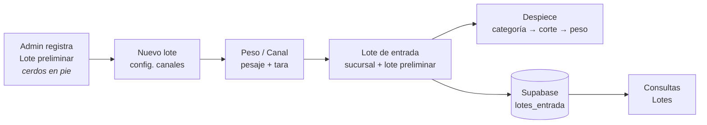

<div align="center">


# Novacarne

**Sistema de gestión para carnicería y procesamiento de cerdo**
Recepción de lotes · Pesaje de canales · Despiece · Inventario · Multisucursal


</div>

---

## 📋 Tabla de contenidos

- [Descripción](#-descripción)
- [Funcionalidades](#-funcionalidades)
- [Roles y permisos](#-roles-y-permisos)
- [Flujo de trabajo de una entrada](#-flujo-de-trabajo-de-una-entrada)
- [Stack tecnológico](#-stack-tecnológico)
- [Estructura del proyecto](#-estructura-del-proyecto)
- [Puesta en marcha](#-puesta-en-marcha)
- [Base de datos y migraciones](#-base-de-datos-y-migraciones)
- [Seguridad](#-seguridad)
- [Historial de avances](#-historial-de-avances)
- [Estado actual y próximos pasos](#-estado-actual-y-próximos-pasos)

---

## 🐖 Descripción

**Novacarne** es una aplicación multiplataforma (Android, iOS y Web) que digitaliza la operación de una carnicería con varias sucursales: desde la compra del cerdo en pie en granja, pasando por la recepción y el pesaje de canales en sucursal, hasta el despiece en cortes y la consulta de lotes y productos.

La app está construida con **Expo Router** y usa **Supabase** como backend (autenticación, base de datos Postgres con RLS y Edge Functions).

---

## ✨ Funcionalidades

### 🔐 Autenticación
- Inicio de sesión con correo y contraseña (Supabase Auth).
- Sesión persistente y refresco automático de token.
- Saludo personalizado con el nombre del usuario y pantalla de carga.
- Modo claro / oscuro.

### 📥 Entradas
| Pantalla | Qué hace |
|---|---|
| **Nuevo lote** | Configura la cantidad de canales a capturar y quién carga (Persona 1 / Persona 2). |
| **Peso / Canal** | Captura el peso de cada canal, descontando la tara de la persona que carga. |
| **Lote de entrada** | Asocia el pesaje a un lote preliminar y a una sucursal; registra número de canales, peso total, notas y quién capturó. |
| **Despiece** | Registro paso a paso: categoría → corte → peso → tara (diablito, cajas, tara especial). |

> El progreso de cada flujo se guarda localmente **por usuario**, así que no se pierde si se cierra la app.

### 🔎 Consultas
- **Lotes**: lotes preliminares con sus entradas, canales capturados, cerdos, peso de granja y costo por kg. Permite modificar los pesos de los canales.
- **Productos**: listado paginado con filtro por categoría y opción de ver archivados. Edición, archivado y restauración **solo para administradores**.

### 🛠️ Registros *(solo administrador)*
- **Perfiles**: alta de usuarios (vía Edge Function), edición de rol y sucursal, baja lógica.
- **Sucursales**: alta, edición, activación/desactivación y baja lógica.
- **Productos**: alta con código de barras, categoría, unidad de medida y precio.
- **Proveedores**: alta de proveedores.
- **Lote preliminar**: compra de cerdo en pie (cantidad, peso total en granja, costo unitario).

---

## 👥 Roles y permisos

| Rol | Entradas | Consultas | Editar productos | Registros |
|---|:---:|:---:|:---:|:---:|
| **Administrador** | ✅ | ✅ | ✅ | ✅ |
| **Cajero** | ✅ | ✅ (lectura) | ❌ | ❌ |
| **Tablajero** | ✅ | ✅ (lectura) | ❌ | ❌ |

Los permisos se aplican en **dos capas**:
1. **App** — se ocultan acciones y el layout `app/registros/_layout.tsx` redirige a quien no es administrador.
2. **Base de datos** — políticas **RLS** en Postgres. Es la capa que realmente protege los datos, aunque alguien use la API directamente.

---

## 🔄 Flujo de trabajo de una entrada



---

## 🧰 Stack tecnológico

| Capa | Tecnología |
|---|---|
| Framework | [Expo](https://expo.dev) SDK 56 · React Native 0.85 · React 19.2 |
| Navegación | Expo Router (rutas por archivos, typed routes) |
| Lenguaje | TypeScript 6 · React Compiler habilitado |
| Backend | [Supabase](https://supabase.com): Auth, Postgres 17, RLS, Edge Functions (Deno) |
| Estado | React Context + AsyncStorage (persistencia por usuario) |
| UI | Componentes propios, `@expo/vector-icons`, `expo-image` |
| Calidad | ESLint (`eslint-config-expo`), `tsc --noEmit` |

---

## 📁 Estructura del proyecto

```
Novacarne/
├── app/                        # Pantallas (Expo Router)
│   ├── _layout.tsx             # Layout raíz: tema, providers, guard de sesión, splash
│   ├── index.tsx               # Menú principal
│   ├── login.tsx
│   ├── entradas/               # Nuevo lote, peso-canal, lotes-entrada, despiece
│   ├── consultas/              # Lotes, productos
│   └── registros/              # Solo admin: perfil, sucursal, producto, proveedor, lote-preliminar
│       └── _layout.tsx         # Guard de rol administrador
├── components/                 # Header, AlertModal
├── contexts/                   # Theme, Entradas, Canal, Despiece
├── lib/
│   ├── supabase.ts             # Cliente de Supabase
│   ├── perfil.ts               # Perfil del usuario con caché
│   └── persistencia.ts         # Helpers de AsyncStorage
├── supabase/
│   ├── config.toml
│   ├── functions/crear-usuario # Edge Function: alta de usuarios (solo admin)
│   └── migrations/             # Esquema y políticas versionadas
└── assets/images/              # Logo e iconografía
```

---

## 🚀 Puesta en marcha

### Requisitos
- Node.js 20+ y npm
- [Supabase CLI](https://supabase.com/docs/guides/cli) (para migraciones y funciones)
- Docker Desktop (solo para comandos de BD como `db pull` / `db dump`)
- Expo Go o un emulador Android/iOS

### Instalación

```bash
git clone <url-del-repo>
cd Novacarne
npm install
```

### Variables de entorno
Crea un archivo `.env` en la raíz:

```env
EXPO_PUBLIC_SUPABASE_URL=https://<project-ref>.supabase.co
EXPO_PUBLIC_SUPABASE_PUBLISHABLE_KEY=<publishable-key>
```

> ⚠️ Nunca pongas la `service_role` key en la app: solo vive en las Edge Functions.

### Ejecutar

```bash
npx expo start        # menú interactivo
npm run android       # Android
npm run ios           # iOS
npm run web           # Navegador
```

### Verificar calidad

```bash
npx tsc --noEmit      # tipos
npm run lint          # ESLint
npx expo-doctor       # salud del proyecto Expo
```

---

## 🗄️ Base de datos y migraciones

El esquema vive versionado en `supabase/migrations/`. Cada archivo se aplica **una sola vez**, en orden por su marca de tiempo.

| Migración | Contenido |
|---|---|
| `20261112000000_esquema_base.sql` | Esquema completo: 22 tablas, funciones y triggers (stock, inventario, despiece, alta de perfiles…) |
| `20261113000000_politicas_rls.sql` | Función `es_admin()` y políticas RLS de las tablas usadas por la app |
| `20261113210000_productos_solo_admin.sql` | Edición/archivado de productos restringido a administradores |

**Tablas principales usadas por la app:** `perfiles`, `sucursales`, `productos`, `proveedores`, `preliminar_lote`, `lotes_entrada`.
**Ya modeladas para próximas fases:** ventas, clientes, cortes de caja, inventario, compras a proveedor, despiece por lote, turnos, vales, entre otras.

### Comandos útiles

```bash
supabase link --project-ref <ref>       # enlazar el proyecto
supabase migration new <nombre>         # nueva migración
supabase migration list                 # comparar local vs remoto
supabase db push                        # aplicar migraciones pendientes
supabase functions deploy crear-usuario # desplegar la Edge Function
```

> 📌 Regla de oro: **nunca edites una migración ya aplicada**; crea una nueva.

---

## 🛡️ Seguridad

- **RLS activado en todas las tablas** del esquema `public`. El rol anónimo no tiene acceso a datos.
- Las tablas aún sin políticas quedan **cerradas por defecto** (solo accesibles con `service_role`).
- **Edge Function `crear-usuario`**: valida el JWT del llamador y exige rol `administrador`; no modifica cuentas existentes.
- Borrado **lógico** (`deleted_at`) en todas las entidades: no se eliminan filas.
- Estado local de Supabase CLI (`supabase/.temp/`) y archivos `.env` fuera de git.

---

## 📈 Historial de avances

| Fecha | Hito |
|---|---|
| **Abr 2026** | Proyecto inicial · pantalla principal, entradas, login y peso/canal · diseño del flujo de entrada de canales |
| **Jun 2026** | Despiece dividido en pasos |
| **Jul 2026** | Integración con Supabase y Auth · componente `Header` y `AlertModal` · registro de perfiles, sucursales y productos (con código de barras) · CRUD de productos y sucursales · roles y botón de registros solo para admin · lote preliminar · integración con `preliminar_lote` y `lotes_entrada` · contexto de entradas por usuario |
| **Ago 2026** | Consulta de lotes y quién capturó · validación de canales vs. cerdos del lote · paginado de productos · pantalla de proveedores · mejora del despiece |
| **Nov 2026** | 🔒 Auditoría de seguridad: Edge Function protegida, políticas RLS, guard de `/registros`, productos solo admin · ⬆️ actualización a Expo SDK 56 · 🧹 limpieza de plantilla y dependencias sin uso · 🗄️ versionado del esquema con migraciones |

---

## 🧭 Estado actual y próximos pasos

### ✅ Listo
- Autenticación, roles y menú por rol
- Flujo de recepción: lote preliminar → pesaje de canales → lote de entrada
- Consultas de lotes y productos
- Catálogos: perfiles, sucursales, productos, proveedores
- Seguridad en base de datos (RLS) y backend versionado

### 🚧 En progreso / pendiente
- [ ] **Guardar el despiece en la base de datos** (hoy solo se guarda en el dispositivo; la tabla `despiece_lote` ya existe)
- [ ] Persistir el pesaje de canales antes de registrar el lote (hoy viaja por parámetros de navegación)
- [ ] Unificar `is_admin()` y `es_admin()` en una sola función
- [ ] Hook de autenticación único (`AuthContext`) y hooks `useResponsive` / `useAlert`
- [ ] Dividir pantallas grandes (`consultas/lotes`, `consultas/producto`, `despiece`, `perfil`)
- [ ] Pruebas automatizadas y CI
- [ ] Actualizar a Expo SDK 57 (corrige una regresión de memoria de Hermes)
- [ ] Siguientes módulos: ventas, inventario por sucursal, cortes de caja, clientes

---

<div align="center">
<sub>Hecho con 🥩 y ☕ — Novacarne © 2026</sub>
</div>
